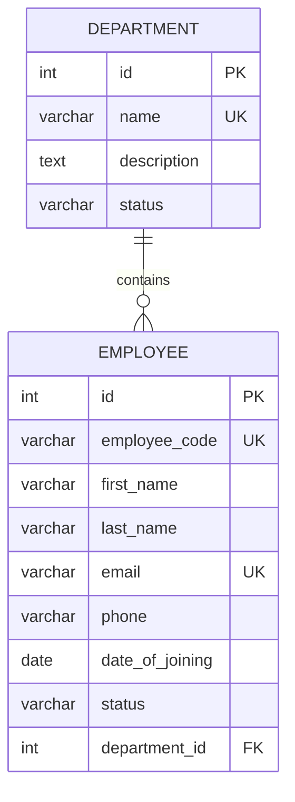

# HRMS ER Diagram

## Implemented Model Relationships

One department can have multiple employees. Each employee belongs to
one department.

## Relationship and Constraints

- Department has a one-to-many relationship with Employee.
- Employee.department references Department.
- Department.name must be unique.
- Employee.employee_code and Employee.email must be unique.
- Employee.department uses `on_delete=models.PROTECT`.
- Department.status and Employee.status default to `Active`.

## Scope and Limitations

This diagram documents the implemented Department and Employee models.
Attendance, Leave, and Payroll are not included because their model
implementations have not been verified.
